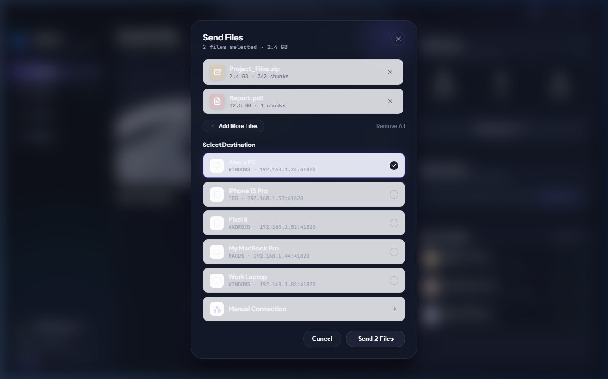
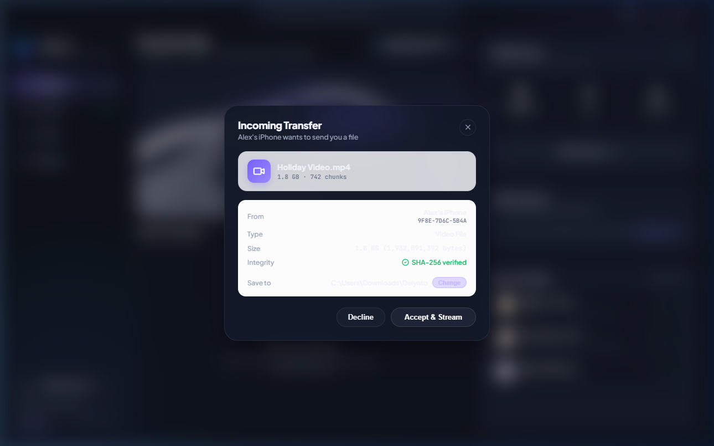

<div align="center">

# ⚡ DELYNTO
### Private • Zero-Cloud • High-Speed Device-to-Device File Transfer

[](https://github.com/impreseo/Delynto-Releases/releases/latest)
[](documentation/system-requirements.md)
[](https://github.com/impreseo/Delynto)
[](documentation/security-and-privacy.md)

<br/>

### **JUST OPEN. DISCOVER. CONNECT. SHARE.**

<br/>

<p align="center">
  <a href="https://github.com/impreseo/Delynto-Releases/releases/latest/download/Delynto-0.1.0-Setup.exe">
    
  </a>
  &nbsp;&nbsp;&nbsp;
  <a href="https://github.com/impreseo/Delynto-Releases/releases/latest/download/Delynto-0.1.0.apk">
    
  </a>
</p>

<p align="center">
  <a href="https://github.com/impreseo/Delynto-Releases/releases/latest">📦 View GitHub Release</a> &nbsp;•&nbsp; 
  <a href="documentation/README.md">📖 Complete Documentation</a> &nbsp;•&nbsp; 
  <a href="https://github.com/impreseo/Delynto">💻 Source Repository</a>
</p>

---

</div>

<br/>

## 🌟 What is Delynto?

**Delynto** is a modern, high-performance file sharing client engineered for instant, zero-cloud peer-to-peer data transfers between Windows PCs and Android devices.

Powered by the custom Rust **RelayMesh** engine, Delynto eliminates central servers, third-party cloud uploads, and user registration. Devices communicate directly over your existing local Wi-Fi, Ethernet, or mobile hotspot network, achieving native wire-speed throughput without bandwidth limits or file size caps.

Designed in **Pearl × Obsidian × Liquid Glass**, Delynto combines a clean visual aesthetic with verified cryptographic security.

---

## 🖥️ Desktop Application Experience (Windows 10 / 11)

Delynto for Windows features a custom frameless window title bar, real-time nearby device radar, drag-and-drop staging, and live transfer monitors.

### Main Transfer Hub & Drop Zone
The main interface allows instant drag-and-drop sending or quick folder browsing with live throughput metrics:


<br/>

### Real-Time Nearby Devices Radar
Discovered computers and phones on your local subnet appear automatically. One tap on a device immediately initiates file selection:


<br/>

### Active Transfer Workspace & Throughput
Monitor multi-file streams and batch directory jobs with real-time speedometers (`MB/s`), chunk counters, and pause/resume controls:


<br/>

### File Selection & Incoming Offer Prompts
Recipients always maintain explicit control over what is saved to their disk with cryptographic sender verification:

<table align="center" width="100%">
  <tr>
    <td width="50%" align="center">
      <b>File Selection & Staging</b><br/>
      
    </td>
    <td width="50%" align="center">
      <b>Incoming Transfer Offer</b><br/>
      
    </td>
  </tr>
</table>

---

## 📱 Mobile Experience (Android 8.0+)

Delynto for Android is built using Jetpack Compose and native JNI bindings to the Rust RelayMesh core. It organizes functionality into an ergonomic 5-tab navigation bar with system share sheet integration and a persistent foreground service.

### Android Nearby Radar & Mobile Hub
Scan for nearby devices, view platform types, and connect with a single tap:

<div align="center">
  
</div>

---

## 🔗 Mutual Cryptographic Pairing & Short Auth String (SAS)

Connecting two devices for the first time requires explicit human authorization. Delynto features three flexible pairing modes:

<table align="center" width="100%">
  <tr>
    <td width="55%" align="center">
      <b>Ephemeral 6-Digit PIN & Direct Connection</b><br/>
      
    </td>
    <td width="45%" valign="top">
      <h4>🔒 Verified Handshake Flow:</h4>
      <ol>
        <li><b>One-Tap Discovery:</b> Tap <i>Connect</i> on any discovered peer.</li>
        <li><b>6-Digit Code:</b> Generate or enter an ephemeral PIN (e.g. <code>482-915</code>) for cross-VLAN setups.</li>
        <li><b>QR Optical Fallback:</b> Scan camera token for air-gapped device linking.</li>
        <li><b>Short Authentication String (SAS):</b> Confirm matching 6-digit visual code (e.g. <code>582-914</code>) on both screens to eliminate machine-in-the-middle attacks.</li>
      </ol>
      <p><i>Once paired, devices are cryptographically remembered in your local SQLite journal for instant future sharing.</i></p>
    </td>
  </tr>
</table>

---

## ⚡ Key Features

- **🚀 Native Local Speeds:** Transfers stream directly over Wi-Fi 5/6, Gigabit Ethernet, or mobile hotspot at maximum hardware capability.
- **🛡️ 100% Zero-Cloud:** No servers, no accounts, no subscriptions, and zero external internet dependencies.
- **🧩 Resumable Transfers:** QUIC segmented chunk pipeline (4 MiB blocks). Interrupted transfers automatically resume from the last verified block without re-sending completed data.
- **📁 Directory & Batch Jobs:** Send thousands of files and entire nested folder structures in a single batch transfer.
- **🛡️ Security Hardened:** Ed25519 node identities, anti-replay session tracking, bidirectional rate limiting, and SHA-256 chunk validation.
- **📂 Path Traversal & Collision Protection:** Sanitizes incoming filenames against directory traversal (`../`) and Windows reserved names (`CON`, `PRN`, `AUX`), appending suffixes (e.g. `File (1).ext`) instead of overwriting existing files.
- **🌓 Obsidian × Pearl Themes:** Switch smoothly between Obsidian dark mode and Pearl light mode with polished typographic contrast.

---

## 🛠️ How Delynto Works

```text
┌───────────────────────┐                                 ┌───────────────────────┐
│     Windows PC        │                                 │    Android Phone      │
│   (RelayMesh Core)    │                                 │   (RelayMesh Core)    │
└───────────┬───────────┘                                 └───────────┬───────────┘
            │                                                         │
            │────── UDP Discovery Beacon (Port 53317) ───────────────►│ (Discovered)
            │◄───── UDP Discovery Beacon (Port 53317) ────────────────│ (Discovered)
            │                                                         │
            │══════ Mutually Authenticated QUIC / TLS 1.3 Handshake ══│ (Port 41820)
            │                                                         │
            │────── 1. TransferManifest (SHA-256 Root Merkle) ───────►│ (Prompt UI)
            │◄───── 2. TransferAccept ────────────────────────────────│ (User Agrees)
            │                                                         │
            │══════ 3. Concurrent 4 MiB Chunks Streaming ═════════════►│ (SHA-256 Check)
            │                                                         │
            │◄───── 4. TransferComplete (Reconstruct & Commit) ───────│ (Saved to Disk)
```

---

## 🚀 Installation & Setup

### 🪟 Windows Desktop
1. Download [**`Delynto-0.1.0-Setup.exe`**](https://github.com/impreseo/Delynto-Releases/releases/latest/download/Delynto-0.1.0-Setup.exe).
2. Double-click the installer.
3. *Windows SmartScreen Note:* Because this open-source beta release is unsigned, SmartScreen may display *"Windows protected your PC"*. Click **"More info"** and then **"Run anyway"**.
4. When prompted by Windows Defender Firewall, check **"Private networks"** and click **"Allow access"**.
5. Delynto installs to `%LOCALAPPDATA%\Programs\Delynto` with Start Menu and Desktop shortcuts.

### 📱 Android Mobile
1. Download [**`Delynto-0.1.0.apk`**](https://github.com/impreseo/Delynto-Releases/releases/latest/download/Delynto-0.1.0.apk).
2. Tap the APK file to install. If prompted, toggle **"Allow installation from this source"** in your settings.
3. Open Delynto and grant storage and notification permissions to permit uninterrupted background transfers.

---

## 🔒 Security & Privacy Principles

- **No Telemetry:** Delynto includes zero analytics beacons, error-tracking telemetry, advertising trackers, or tracking cookies.
- **Cryptographic Trust:** Node keys are self-sovereign Ed25519 pairs generated locally via CSPRNG.
- **Explicit Recipient Consent:** Receiving devices must explicitly accept incoming files before bytes are written to storage.
- **Device Revocation:** Blocked or forgotten devices are rejected immediately at the network control plane.

---

## 💻 System Requirements

| Platform | Minimum Version | Recommended Hardware | Network |
| :--- | :--- | :--- | :--- |
| **Windows Desktop** | Windows 10 (64-bit, Build 19041+) / Windows 11 | Multi-core x86_64 CPU, 4 GB RAM, SSD | Wi-Fi 5/6 (5 GHz) or Gigabit LAN |
| **Android Mobile** | Android 8.0 Oreo (API 26+) | 64-bit ARM (`arm64-v8a`), 4 GB RAM | 5 GHz Wi-Fi or Personal Hotspot |

---

## 📚 Complete Documentation Library

For in-depth guides, visit the [`documentation/`](documentation/README.md) directory:

- 📘 [Product Overview](documentation/product-overview.md)
- 🪟 [Windows Desktop Guide](documentation/windows-guide.md)
- 📱 [Android Mobile Guide](documentation/android-guide.md)
- 🔗 [Connection & Pairing Guide](documentation/connection-and-pairing.md)
- 📁 [File Transfer & Resumption Guide](documentation/file-transfer-guide.md)
- 🛡️ [Security & Cryptography Specification](documentation/security-and-privacy.md)
- 🛠️ [Troubleshooting Matrix](documentation/troubleshooting.md)
- 📋 [System Requirements Specification](documentation/system-requirements.md)
- 🏷️ [Release Build Details & Toolchain](documentation/release-details.md)
- 📸 [Screenshots Gallery Catalog](documentation/screenshots/README.md)

---

## ⚠️ Known Network Limitations

- **Public Wi-Fi AP Isolation:** Public networks (hotels, airports, universities) often prohibit direct peer-to-peer traffic. On such networks, turn on your Android **Personal Hotspot** and connect your PC to it, or use the 6-digit code direct connect.
- **Windows Firewall:** Ensure Windows Defender Firewall allows local UDP communication for Delynto on Private networks.
- **Physical Hardware Notice:** Automated socket tests, JNI FFI bindings, and cryptographic protocols have been validated with 100% test pass rates; physical field validation across specific phone models should be verified on your target hardware.

---

## 🔐 Checksum Verification

Verify the cryptographic SHA-256 integrity of your downloaded packages:

| Package | Size | SHA-256 Checksum |
| :--- | :--- | :--- |
| **`Delynto-0.1.0-Setup.exe`** | 11,632,757 bytes (~11.09 MiB) | `317f9e2409cfcba3ca687e914d2d0dc5f983839ae99cd743ff92720db7fa07d0` |
| **`Delynto-0.1.0.apk`** | 27,415,905 bytes (~26.14 MiB) | `ae4e3a9029ef7a82bfa0e2336864492e1e68e5b44187aee1b819903854c1780b` |

### Windows PowerShell:
```powershell
Get-FileHash .\Delynto-0.1.0-Setup.exe -Algorithm SHA256
```

### Linux / macOS / Android Termux (Bash):
```bash
sha256sum -c SHA256SUMS.txt
```

---

<div align="center">

### Delynto is powered by **IMPRESEO LABS**
*Copyright © 2026 IMPRESEO LABS. All rights reserved.*

[Primary Source Repository](https://github.com/impreseo/Delynto) • [Report an Issue](https://github.com/impreseo/Delynto/issues) • [Releases](https://github.com/impreseo/Delynto-Releases/releases)

</div>
