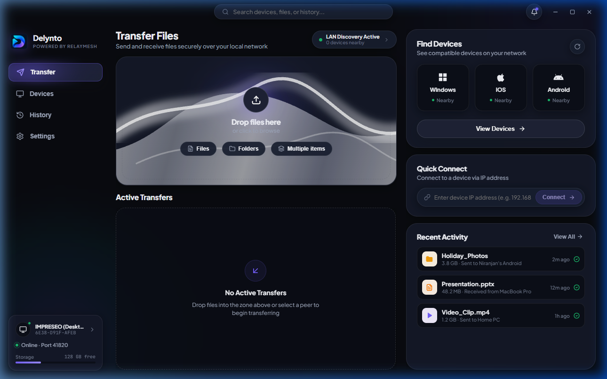
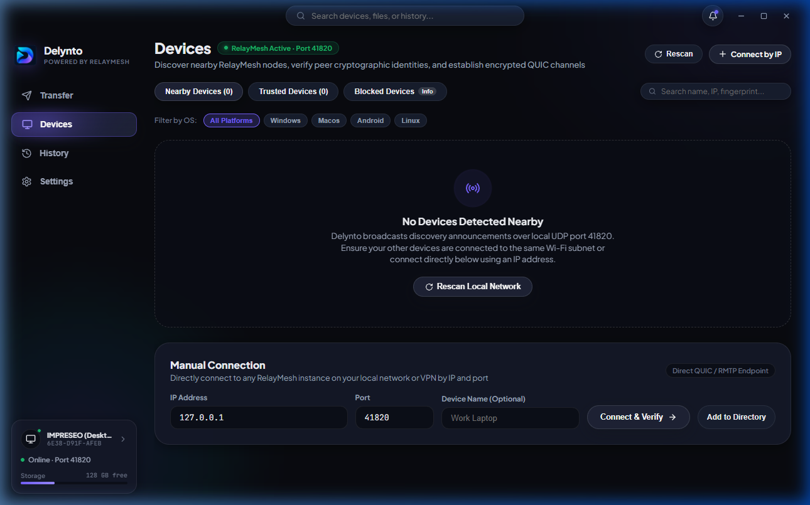
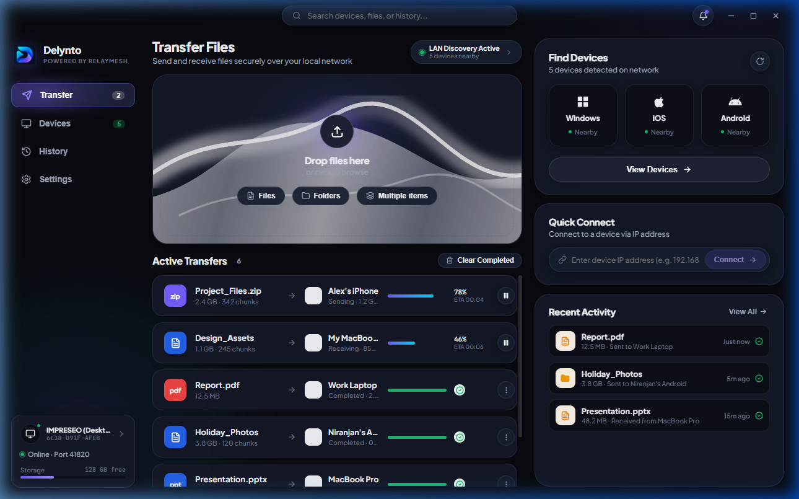
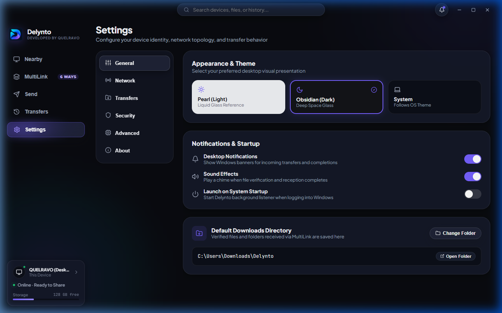
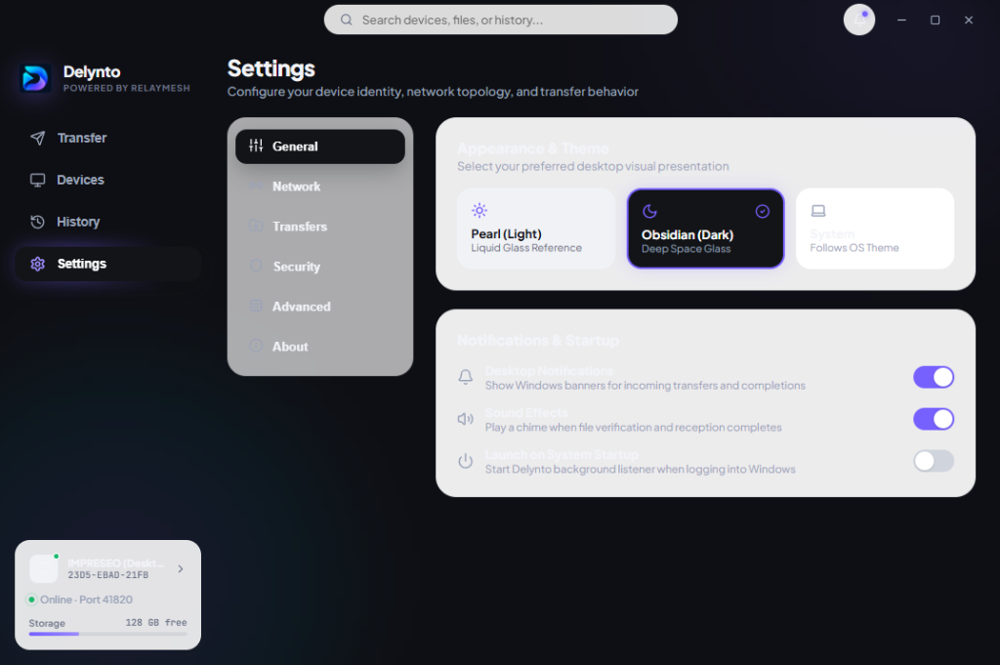
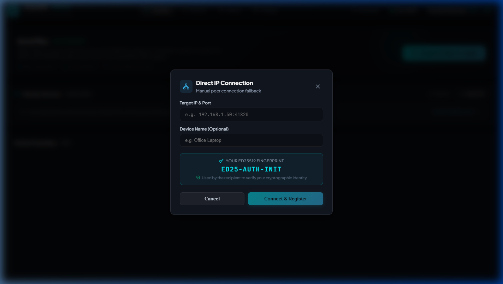

<div align="center">


# DELYNTO

### **JUST OPEN. DISCOVER. CONNECT. SHARE.**

**Private • Zero-Cloud • High-Speed Device-to-Device File Transfer**

[](https://github.com/impreseo/Delynto-Releases/releases/tag/v0.1.2)
[](https://github.com/impreseo/Delynto-Releases/releases/latest)
[](documentation/system-requirements.md)
[](LICENSE)
[-6366F1?style=for-the-badge)](documentation/security-and-privacy.md)

<br/>

**Powered by IMPRESEO LABS**

---

</div>

<br/>

## 📥 Official Downloads (v0.1.2 — Hotspot Connectivity & UX Update)

Download the official production packages for your operating system. All downloads operate 100% offline and do not require account registration or cloud sign-in.

<table align="center" width="100%">
  <thead>
    <tr>
      <th width="50%" align="center">🪟 Windows Desktop</th>
      <th width="50%" align="center">📱 Android Mobile</th>
    </tr>
  </thead>
  <tbody>
    <tr>
      <td align="center" valign="top">
        <br/>
        <a href="https://github.com/impreseo/Delynto-Releases/releases/download/v0.1.2/Delynto-0.1.2-Setup.exe">
          
        </a>
        <br/><br/>
        <b>Package:</b> <code>Delynto-0.1.2-Setup.exe</code><br/>
        <b>Version:</b> <code>v0.1.2</code> (Hotspot Connectivity & UX Update)<br/>
        <b>Architecture:</b> <code>x86_64</code> (64-bit Intel / AMD)<br/>
        <b>File Size:</b> 11,634,858 bytes (~11.10 MiB)<br/>
        <b>Format:</b> NSIS Standalone Installer<br/>
        <b>Requirements:</b> Windows 10 (Build 19041+) or Windows 11<br/>
        <br/>
        <a href="documentation/windows-guide.md">📘 Read Windows Guide</a> • <a href="documentation/installation-guide.md#windows-desktop-installation">🛠️ Installation Steps</a>
        <br/><br/>
      </td>
      <td align="center" valign="top">
        <br/>
        <a href="https://github.com/impreseo/Delynto-Releases/releases/download/v0.1.2/Delynto-0.1.2.apk">
          
        </a>
        <br/><br/>
        <b>Package:</b> <code>Delynto-0.1.2.apk</code><br/>
        <b>Version:</b> <code>v0.1.2</code> (Hotspot Connectivity & UX Update)<br/>
        <b>Supported ABIs:</b> <code>arm64-v8a</code>, <code>x86_64</code><br/>
        <b>File Size:</b> 27,415,905 bytes (~26.14 MiB)<br/>
        <b>Format:</b> Android Application Package (APK)<br/>
        <b>Requirements:</b> Android 8.0 Oreo (API 26) or newer<br/>
        <br/>
        <a href="documentation/android-guide.md">📱 Read Android Guide</a> • <a href="documentation/installation-guide.md#android-installation">🛠️ Sideload Steps</a>
        <br/><br/>
      </td>
    </tr>
  </tbody>
</table>

### 🔒 Cryptographic Checksum Verification
Verify the cryptographic authenticity of your download prior to execution:

| Binary Asset | Exact File Size | Cryptographic SHA-256 Hash |
| :--- | :--- | :--- |
| **`Delynto-0.1.2-Setup.exe`** | 11,634,858 bytes | `efb3ff7a6ed1466faa97d77752a45855fd2147b99748aed7acf4a09110aa152f` |
| **`Delynto-0.1.2.apk`** | 27,415,905 bytes | `ae4e3a9029ef7a82bfa0e2336864492e1e68e5b44187aee1b819903854c1780b` |

```powershell
# Windows PowerShell
Get-FileHash .\Delynto-0.1.2-Setup.exe -Algorithm SHA256
```

```bash
# Linux / macOS / Android Termux
sha256sum Delynto-0.1.2.apk
# Or verify manifest
sha256sum -c SHA256SUMS.txt
```

---

## 🌟 What is Delynto?

**Delynto** is an executive-grade, local-first file sharing system engineered for instant, zero-cloud data transfers between Windows PCs and Android devices.

By eliminating third-party cloud servers, external relays, user registration, and telemetry, Delynto allows your devices to establish direct, authenticated connections over local Wi-Fi, Ethernet, or mobile hotspots. Powered by the custom Rust **RelayMesh** engine, Delynto transfers multi-gigabyte collections at full physical hardware wire speeds without artificial throughput caps, file size ceilings, or bandwidth metering.

### The Delynto Experience
$$\textbf{OPEN} \longrightarrow \textbf{DISCOVER} \longrightarrow \textbf{CONNECT} \longrightarrow \textbf{SHARE}$$

1. **OPEN:** Launch Delynto on your computer and phone. No login, sign-up, or cloud setup required.
2. **DISCOVER:** Nearby peers appear automatically via low-latency local UDP radar beacons.
3. **CONNECT:** Establish trust through one-tap pairing, an ephemeral 6-digit PIN, or camera QR optical scan.
4. **SHARE:** Drag and drop files, directories, or media. Bytes stream directly across your local network.

---

## 📸 Product Showcase

Every image below is a genuine, unedited capture of the active Delynto runtime on Windows 11 and Android.

### 🖥️ Windows Desktop Experience

<table align="center" width="100%">
  <tr>
    <td width="50%" align="center">
      <b>Main Transfer Hub & Drop Zone</b><br/>
      <a href="documentation/screenshots/desktop/desktop-home.png">
        
      </a>
      <sub>Instant drag-and-drop file staging with storage directory controls.</sub>
    </td>
    <td width="50%" align="center">
      <b>Nearby Devices Radar</b><br/>
      <a href="documentation/screenshots/desktop/desktop-nearby-devices.png">
        
      </a>
      <sub>Real-time peer discovery showing verified platform types and connection status.</sub>
    </td>
  </tr>
  <tr>
    <td width="50%" align="center">
      <br/><b>Active Multi-Stream Transfers</b><br/>
      <a href="documentation/screenshots/desktop/desktop-transfers.png">
        
      </a>
      <sub>Live speedometer (`MB/s`), chunk progress indicators, and pause/resume controls.</sub>
    </td>
    <td width="50%" align="center">
      <br/><b>Settings & Node Diagnostics</b><br/>
      <a href="documentation/screenshots/desktop/desktop-settings.png">
        
      </a>
      <sub>Obsidian × Pearl theme toggle, Ed25519 node fingerprint, and port configuration.</sub>
    </td>
  </tr>
</table>

### 📱 Android Mobile Experience & Cross-Platform Flow

<table align="center" width="100%">
  <tr>
    <td width="35%" align="center" valign="middle">
      <b>Android Nearby Radar</b><br/>
      <a href="documentation/screenshots/android/android-nearby.png">
        
      </a>
      <br/>
      <sub>Ergonomic 5-tab Jetpack Compose interface with background service integration.</sub>
    </td>
    <td width="65%" valign="top">
      <h4>📱 Native Mobile Architecture Highlights:</h4>
      <ul>
        <li><b>Radar Discovery Tab:</b> Live beacon receiver detects nearby computers and phones automatically.</li>
        <li><b>Send Tab:</b> Native Android Storage Access Framework (SAF) integration for photos, videos, documents, and folders.</li>
        <li><b>Receive Tab:</b> Explicit transfer prompts displaying sender node identity and incoming manifest details.</li>
        <li><b>History & Transfers:</b> Foreground service with ongoing Android notification drawer progress bars.</li>
        <li><b>Settings Tab:</b> Custom device naming, fingerprint verification, and trusted device revocation.</li>
      </ul>
      <br/>
      <h4>🤝 Mutual Human-Friendly Pairing:</h4>
      <p align="center">
        <a href="documentation/screenshots/desktop/desktop-pairing.png">
          
        </a>
      </p>
      <sub>Ephemeral 6-digit codes and Short Authentication String (SAS) eliminate machine-in-the-middle attacks.</sub>
    </td>
  </tr>
</table>

---

## ⚡ Key Features

| Capability | Supported in v0.1.1 | Description |
| :--- | :---: | :--- |
| **Zero-Cloud Architecture** | ✅ Supported | All transfers operate strictly within your local network. Zero external servers or telemetry. |
| **Wire-Speed QUIC Transport** | ✅ Supported | Multiplexed QUIC over UDP with TLS 1.3 encryption (Port `41820`), streaming at hardware limits. |
| **Active Network Discovery** | ✅ Supported | Active OS interface enumeration (`GetAdaptersAddresses` / `getifaddrs`) for LAN, Wi-Fi, and hotspot radar. |
| **Ephemeral 6-Digit PIN Pairing** | ✅ Supported | Instant pairing using temporary 6-digit codes or direct IP entry for cross-VLAN setups. |
| **Short Authentication String (SAS)** | ✅ Supported | Matching 6-digit visual code confirmation prevents machine-in-the-middle tampering. |
| **QR Code Optical Linking** | ✅ Supported | Optical camera fallback for air-gapped device linking without manual typing. |
| **Resumable 4 MiB Chunks** | ✅ Supported | Large transfers divide into 4 MiB blocks; interrupted transfers resume without re-transmitting verified chunks. |
| **Directory & Batch Jobs** | ✅ Supported | Transmit nested folder structures and multi-file queues in a single coordinated job. |
| **Path Traversal Protection** | ✅ Supported | Automatic sanitization against `../` path traversal and Windows reserved filenames (`CON`, `PRN`, `AUX`). |
| **Obsidian × Pearl Themes** | ✅ Supported | High-contrast visual design engineered for both low-light and bright desktop environments. |
| **macOS & Linux Clients** | ⏳ Planned | Native macOS (`.dmg`) and Linux (`.AppImage`, `.deb`) packages are scheduled for future milestones. |
| **BLE Discovery Fallback** | ⏳ Planned | Bluetooth Low Energy beacon fallback for environments where local UDP broadcast is disabled. |

---

## 🛠️ How Delynto Works

Delynto's core communication relies on the **RelayMesh** protocol architecture, implemented in pure Rust for optimal memory safety, concurrency, and performance:

```text
┌────────────────────────────────┐                             ┌────────────────────────────────┐
│          Windows PC            │                             │         Android Phone          │
│       (RelayMesh Core)         │                             │        (RelayMesh Core)        │
└───────────────┬────────────────┘                             └───────────────┬────────────────┘
                │                                                              │
                │──────── UDP Discovery Beacon (Port 53317) ──────────────────►│ (Discovered)
                │◄─────── UDP Discovery Beacon (Port 53317) ───────────────────│ (Discovered)
                │                                                              │
                │════════ Mutual Cryptographic SAS / QR Pairing ═══════════════│ (Trust Approved)
                │                                                              │
                │════════ Mutually Authenticated QUIC / TLS 1.3 ═══════════════│ (Port 41820)
                │                                                              │
                │──────── 1. TransferManifest (SHA-256 Merkle Roots) ─────────►│ (Recipient Prompt)
                │◄─────── 2. TransferAccept (User Consent) ────────────────────│ (Approval Granted)
                │                                                              │
                │════════ 3. Concurrent 4 MiB Chunks Streaming ════════════════►│ (Chunk Verification)
                │                                                              │
                │◄─────── 4. TransferComplete (Reconstruct & Commit) ──────────│ (Committed to Disk)
```

1. **Discovery:** Devices announce presence on local UDP port `53317`. Interfaces are continuously evaluated to discover peers on Wi-Fi, Ethernet, and hotspots without internet access.
2. **Mutual Pairing:** Establishing pairing exchanges Ed25519 public keys. A 6-digit Short Authentication String (SAS) is visually confirmed on both screens.
3. **Session Establishment:** Communications transition to a dedicated QUIC connection encrypted via TLS 1.3 on UDP port `41820`.
4. **Manifest Offer & Acceptance:** The sender transmits an offer manifest containing filenames, sizes, relative directory structures, and SHA-256 chunk hashes. The recipient must explicitly accept.
5. **Streaming & Integrity:** Data is multiplexed in parallel 4 MiB blocks. Every received block is validated against its pre-declared hash before assembly into the final destination file.

---

## 🛡️ Security & Privacy Architecture

Delynto was engineered with security and personal privacy as fundamental requirements:

- **Local-First & Offline:** Transferred bytes never leave your local physical or wireless network. Delynto functions seamlessly on isolated networks, travel routers, and offline mobile hotspots.
- **Self-Sovereign Identity:** Device identities are self-generated Ed25519 cryptographic keypairs generated using local CSPRNG. No centralized public key infrastructure or identity provider is consulted.
- **Explicit Recipient Consent:** No device can push data directly onto your disk without explicit confirmation. Every transfer displays file names, total size, and sender identity before transfer begins.
- **Collision Avoidance:** Existing files are protected from overwriting. If a collision occurs, a non-destructive numbered suffix (e.g. `Report (1).pdf`) is applied automatically.
- **Path Sanitization:** All relative directory paths are strictly stripped of root indicators and directory traversal elements (`../`, `..\`) to prevent filesystem escape attacks.
- **Zero Telemetry:** Delynto includes no telemetry collectors, crash reporting analytics, ad networks, tracking pixels, or third-party SDKs.

---

## 💻 System Requirements

| Operating System | Minimum Version | Recommended Hardware | Network Interface |
| :--- | :--- | :--- | :--- |
| **Windows Desktop** | Windows 10 (64-bit, Build 19041+) or Windows 11 | Multi-core x86_64 CPU, 4 GB RAM, Solid State Drive (SSD) | Wi-Fi 5/6 (5 GHz) or Gigabit Ethernet |
| **Android Mobile** | Android 8.0 Oreo (API 26+) | 64-bit ARM (`arm64-v8a`) or `x86_64`, 4 GB RAM | 5 GHz Wi-Fi or Personal Hotspot |

---

## 📚 Complete Documentation Library

Comprehensive technical documentation, protocol specifications, and platform-specific guides are located in the [`documentation/`](documentation/README.md) directory:

- 📘 [**Product Overview**](documentation/product-overview.md) — Architecture, capabilities, and design principles.
- 🛠️ [**Installation Guide**](documentation/installation-guide.md) — Step-by-step setup for Windows desktop and Android mobile.
- 🪟 [**Windows Desktop Guide**](documentation/windows-guide.md) — Frameless title bar, tray integration, drag-and-drop, and settings.
- 📱 [**Android Mobile Guide**](documentation/android-guide.md) — Sideloading, Jetpack Compose tabs, and foreground service transfers.
- 🔗 [**Connection & Pairing Guide**](documentation/connection-and-pairing.md) — Radar discovery, 6-digit codes, SAS confirmation, and QR linking.
- 📁 [**File Transfer Guide**](documentation/file-transfer-guide.md) — Batch queuing, folder transfers, speedometers, and chunk resumption.
- 🛡️ [**Security & Privacy Specification**](documentation/security-and-privacy.md) — Cryptographic identities, TLS 1.3 QUIC, and zero-cloud integrity.
- 📋 [**System Requirements**](documentation/system-requirements.md) — Hardware, OS build compatibility, and network environment specs.
- 🏷️ [**Release Details & Verification**](documentation/release-details.md) — Compiler toolchain, test suite results, and build provenance.
- 🔐 [**Cryptographic Checksums**](documentation/checksums.md) — SHA-256 verification instructions for all release binaries.
- 🛠️ [**Troubleshooting Guide**](documentation/troubleshooting.md) — Resolving public Wi-Fi AP isolation, firewall alerts, and SmartScreen warnings.
- 📸 [**Screenshots Catalog**](documentation/screenshots/README.md) — High-resolution screenshot gallery with genuine app captures.

---

## ⚠️ Important Public Beta Notes

1. **Unsigned Windows Beta:** Because this open-source release is not signed with an expensive commercial EV certificate, Windows Defender SmartScreen may display an alert (*"Windows protected your PC"*). Click **"More info"** followed by **"Run anyway"**.
2. **Windows Firewall Access:** Windows Defender Firewall will prompt for network access on first launch. Allow communication on **"Private networks"** to enable local UDP peer discovery and QUIC transfer streaming.
3. **Public Wi-Fi AP Isolation:** Public networks (hotels, airports, universities) often prohibit direct peer-to-peer traffic between connected clients. In such environments, turn on your Android phone's **Personal Hotspot** and connect your computer to it, or use the 6-digit PIN direct connect mode.
4. **Field Verification:** Automated cross-platform test suites, socket loopback pipelines, and JNI bindings have achieved a 100% test pass rate (52/52 tests). Verification across diverse physical phone hardware models should be evaluated in your target deployment environment.

---

<div align="center">

<br/>

### **DELYNTO** is powered by **IMPRESEO LABS**
*Copyright © 2026 IMPRESEO LABS. All rights reserved.*

[Official Release](https://github.com/impreseo/Delynto-Releases/releases/tag/v0.1.1) • [Source Code Repository](https://github.com/impreseo/Delynto) • [Report an Issue](https://github.com/impreseo/Delynto/issues) • [Documentation](documentation/README.md) • [Changelog](CHANGELOG.md)

</div>
