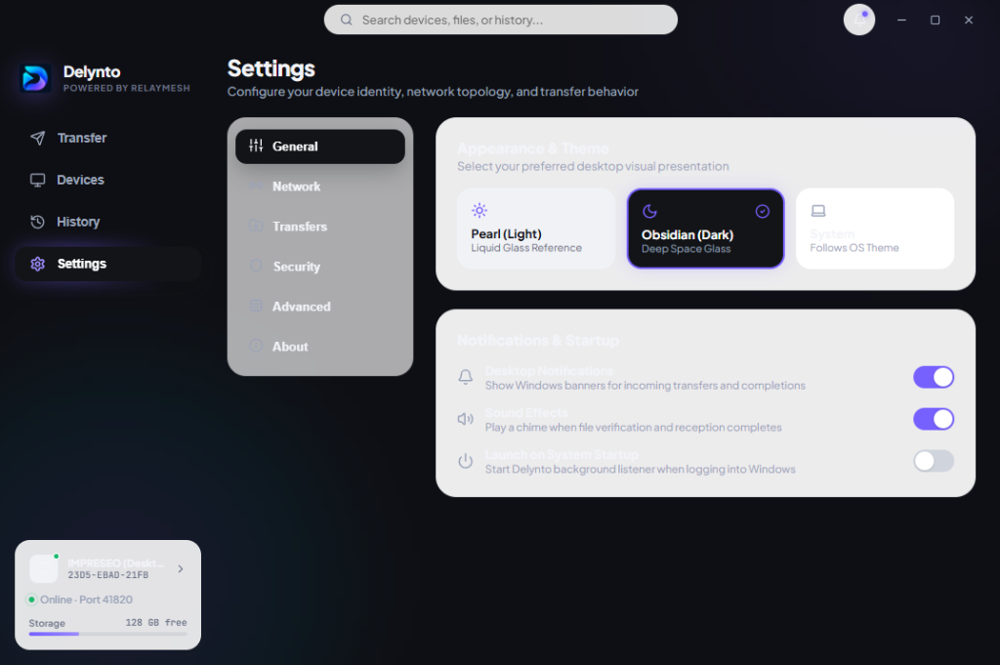

# Delynto — Android Mobile User Guide

**Product:** Delynto for Android  
**Target:** Android 8.0+ (API 26+)  
**Architectures:** `arm64-v8a`, `x86_64`  
**Developed by QUELRAVO • MultiLink**

---

## Mobile Interface & Navigation

Delynto for Android is written in Kotlin using Jetpack Compose and connects directly to the high-performance Rust RelayMesh engine via JNI (`librelaymesh_ffi.so`).

The mobile app organizes navigation into five clear bottom tabs:

1. **Nearby:** Real-time discovery list showing local computers, phones, and tablets.
2. **Send:** File and media selection view for picking photos, videos, documents, or apps to transmit.
3. **Receive:** Incoming offer manager and download queue.
4. **Transfers:** Active transfer monitor showing speeds, percentages, and cancellation controls.
5. **Settings:** Storage directory selector, device name configuration, and network diagnostics.

---

## Discovering & Pairing Peers

1. Open Delynto on your Android device and keep Wi-Fi enabled.
2. Nearby computers and mobile devices running Delynto will appear in the **Nearby** list.
3. **First-Time Pairing:**
   - Tap **"Connect"** on a new peer.
   - Both devices will display an identical 6-digit Short Authentication String (SAS) code (e.g. `582-914`).
   - Confirm the code matches and tap **"Accept & Trust"**.
   - The device is added to your secure trust journal.
4. **Offline Hotspot Mode:**
   - If no Wi-Fi router is available, turn on your Android **Personal Hotspot**.
   - Connect your Windows PC or other phone to the hotspot.
   - Open Delynto on both devices — discovery works without internet access!

---

## Sending Files from Android

1. In Delynto, tap the **Send** tab.
2. Tap **"Select Files"** to open the native Android system file picker (Storage Access Framework).
3. Select any number of files or media items.
4. Pick the target device from your discovered or trusted peer list.
5. Once the receiver accepts, the transfer streams at maximum local Wi-Fi speeds.

### System Share Sheet Integration
You can also share files directly from any Android app (Google Photos, Files by Google, Gallery, WhatsApp):
1. In your gallery or file manager, tap **Share**.
2. Select **Delynto** from the system share sheet.
3. Choose the recipient device to send instantly.

---

## Background Transfer Service

Android aggressively throttles background processes to conserve battery. Delynto prevents transfer interruptions through a native Android Foreground Service:
- When a file transfer begins, Delynto starts `TransferForegroundService` with a persistent notification in your status bar.
- Shows real-time progress, file name, and current transfer speed.
- Automatically acquires a CPU WakeLock and Wi-Fi Multicast Lock to keep data streaming even when the screen turns off.
- The service stops automatically when the transfer completes or is cancelled.

---

## Storage & Downloads

- By default, received files are stored in your device's public **Downloads** directory (`/storage/emulated/0/Download/Delynto/`).
- Files saved here are immediately accessible in your Gallery, Files app, and media players.
- You can change the destination folder anytime in the **Settings** tab.
