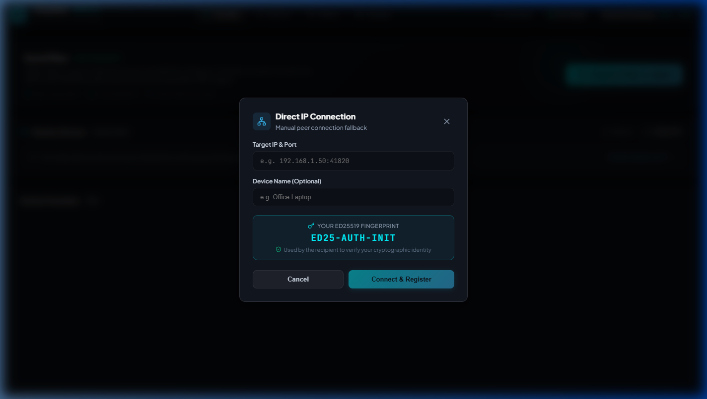

# Delynto — Connection & Pairing Guide

**Product Principle:** *JUST OPEN. DISCOVER. CONNECT. SHARE.*  
**Powered by IMPRESEO LABS**

---

## 1. Automatic Discovery Architecture

Delynto implements zero-configuration peer discovery without central servers:
- **UDP Broadcast / Multicast Service:** Periodically broadcasts presence packets on port `53317`.
- **Payload Verification:** Broadcast packets contain the sender’s temporary discovery ID, device name, and listening port.
- **Active OS Interface Enumeration:** The engine queries active operating system network adapters (`if_addrs`), accurately discovering:
  - Windows Wi-Fi and Ethernet adapters.
  - Android Wi-Fi and Local-Only Hotspots (`192.168.43.x` / `192.168.49.x`).
  - Offline ad-hoc mesh networks.
  - Automatically filters out loopback (`127.0.0.1`), link-local auto-config (`169.254.x.x`), and IPv6 link-local addresses.

---

## 2. Pairing & Trust Establishment



Connecting two devices for the first time requires explicit mutual authentication to prevent machine-in-the-middle attacks.

### Flow Diagram

```text
Initiator                                          Responder
   │                                                   │
   │──── 1. Create Invitation (session_id, token) ────►│ (via QR or 6-Digit PIN)
   │                                                   │
   │◄─── 2. PairRequest (signed session_id) ───────────│
   │                                                   │
   │──── 3. PairOffer (Ed25519 PubKey, Signed Challenge) ─► UI Confirmation
   │                                                   │
   │◄─── 4. PairConfirm (Ed25519 PubKey, SAS Code) ────│
   │                                                   │
   ▼                                                   ▼
[Mutual SAS Display]                             [Mutual SAS Display]
   │                                                   │
   └────────── Verified & Added to Journal ────────────┘
```

### 1. Six-Digit Short Pairing Code
For quick manual connections when devices are on separate VLANs or when broadcast packets are filtered:
1. Tap **"Pair Device"** > **"Invite"** to generate an ephemeral 6-digit PIN (e.g. `482-915`).
2. On the other device, tap **"Join"** and enter the 6-digit PIN.
3. The devices find each other over the local network and prompt for confirmation.

### 2. QR Code Optical Fallback
1. Device A displays a pairing QR code containing the session UUID and local network candidates.
2. Device B scans the QR code or pastes the URI (`delynto://pair?data=...`).
3. Handshake initiates immediately without manual IP address entry.

### 3. Short Authentication String (SAS) Verification
Both devices compute a deterministic 6-digit visual code derived from the SHA-256 digest of both public keys and the session UUID:
- If both screens show **`582-914`**, you are guaranteed that no attacker is intercepting the connection.
- Click **"Trust & Connect"** on both screens to establish permanent cryptographic trust.

---

## 3. Trusted-Device Reconnection

Once paired:
- Each peer's Ed25519 public key and name are saved in the local SQLite `journal.db`.
- When previously paired devices come within Wi-Fi range again, they are immediately recognized as **Trusted**.
- Reconnecting or sending files requires no pairing codes or SAS confirmations.

---

## 4. Revocation & Forget Device

If a device is lost, sold, or compromised:
1. Go to **Settings** > **Trusted Devices** (or Nearby Devices).
2. Click **"Revoke Device"**.
3. The peer’s public key is marked revoked in your local SQLite journal.
4. Any future connection or file transfer attempts from that device are rejected immediately at the control plane.
