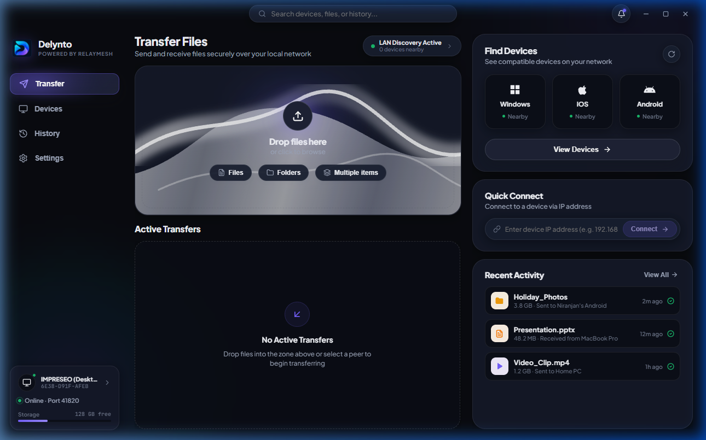
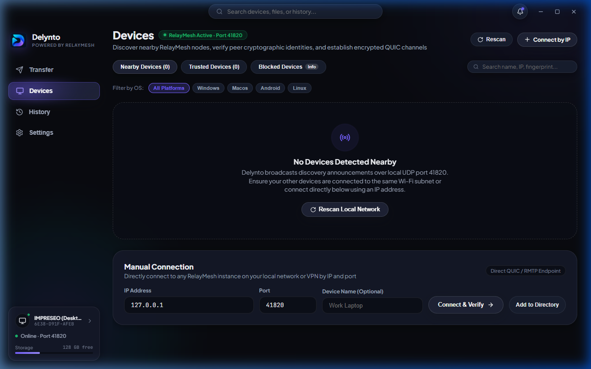
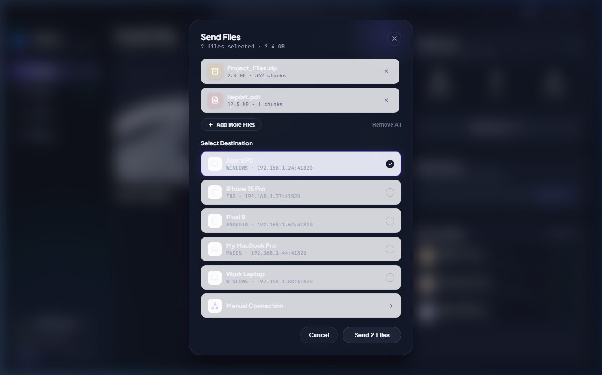
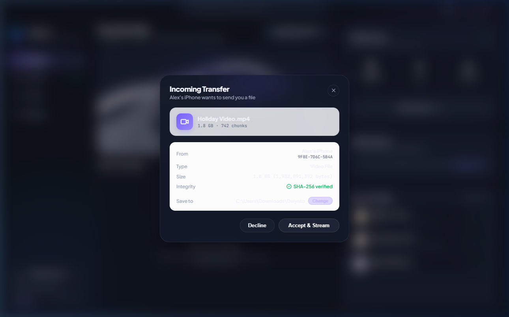
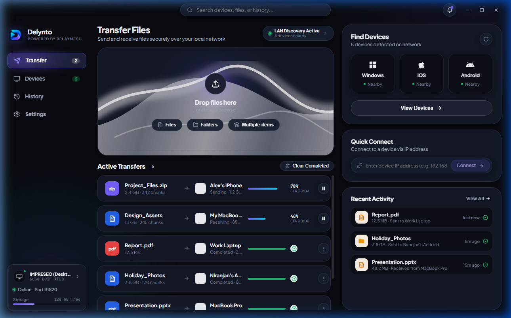
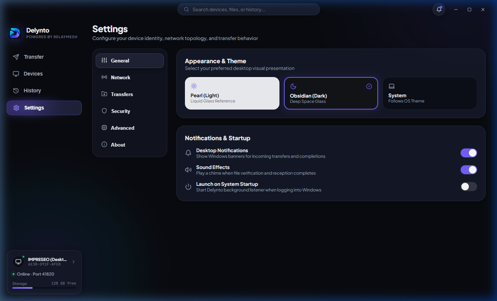

# Delynto — Windows Desktop User Guide

**Product:** Delynto for Windows  
**Architecture:** `x86_64` (64-bit native executable)  
**Powered by IMPRESEO LABS**

---

## Interface Layout & Navigation

Delynto for Windows provides a native desktop interface featuring a custom-styled, frameless window title bar and intuitive sidebar navigation:

### 1. Custom Frameless Title Bar
- Left side: Delynto branding and current network status indicator.
- Right side: Window controls (Minimize, Maximize/Restore, and Close).
- Fully draggable along the entire header.

### 2. Primary Navigation Tabs
- **Send & Receive (Transfer View):** The primary hub showing active transfer cards, speeds, remaining times, and quick drag-and-drop file target zones.
- **Nearby Devices:** Real-time dynamic radar showing all active peers discovered on the current subnet.
- **Transfer History:** Chronological log of past transfers with file names, sizes, peer fingerprints, and completion timestamps.
- **Settings:** Local storage directory management, device renaming, port diagnostics, network interface inspection, and theme selection.

---

## Discovering and Connecting Devices

1. Open **Nearby Devices**.
2. Delynto automatically sends UDP discovery beacons across all physical Wi-Fi and Ethernet adapters.
3. When a peer appears:
   - **Trusted Peers:** Display a green shield icon and an immediate **"Send"** button.
   - **New Peers:** Display a **"Connect"** button to start the one-time cryptographic pairing handshake.
4. Clicking a device card prompts the Windows native file picker to select files for immediate transmission.

---

## Sending Files

Delynto offers three ways to initiate file transfers:
1. **Drag-and-Drop:** Drag files or folders directly from Windows Explorer into the Delynto transfer drop zone.
2. **File Picker:** Click **"Pick Files"** or **"Pick Folder"** to select items via the Windows file browser.
3. **Direct Device Sending:** Click the **"Send"** button on any discovered device card.

---

## Receiving Files

When an incoming file transfer is offered:
1. Delynto presents an **Incoming Transfer Offer** dialog displaying:
   - Sender device name and verified cryptographic fingerprint.
   - File name, total size, and number of 4 MiB transfer chunks.
2. Click **"Accept"** to begin streaming the file directly to your `Downloads\Delynto` folder.
3. Click **"Decline"** to reject the transfer. The sender receives an immediate cancellation notice without transmitting any chunk data.

---

## Transfer Management & History

- **Real-Time Progress:** View real-time transfer throughput (e.g. `120 MB/s`), progress percentage, and chunk verification counts.
- **Pause & Resume:** If a network cable is disconnected or Wi-Fi drops, the transfer enters an **Interrupted** state. Once connectivity returns, click **"Resume"** to pick up from the last verified chunk.
- **Open in Explorer:** Click the folder icon on any completed transfer to open the file directly in Windows File Explorer.

---

## Desktop Settings

- **Storage Location:** Click **"Browse"** to change the default directory where received files are saved.
- **Device Identity:** View your local Ed25519 node fingerprint and customize your broadcast device name.
- **Theme Selection:** Toggle seamlessly between **Obsidian Dark** (default) and **Pearl Light** modes.
- **Diagnostics:** View active network IP candidates, listen port (`41820`), and protocol version.
